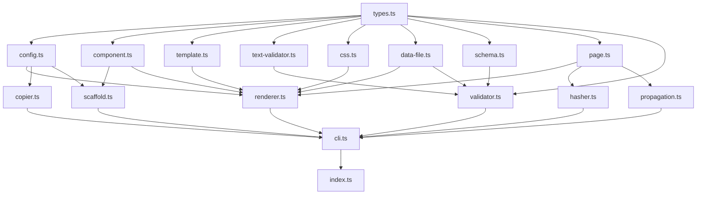

# HTML Engine — Implementation Plan

> **Audience**: AI coding agent  
> **Source specs**: [`html-engine.md`](./html-engine.md), [`stack.md`](./stack.md)  
> **Status**: ready  
> **Created**: 2026-07-04

## Progress Tracker

Mark phases as completed. Update `Files` column with actual file paths created during implementation.

| # | Phase | Status | Files | Test | Notes |
|---|-------|--------|-------|------|-------|
| 1 | Skeleton & Types | ✅ done | `src/types.ts`, `src/index.ts` | `tsc --noEmit` | |
| 2 | Config & Component Parser | ✅ done | `src/config.ts`, `src/component.ts` | parse hero fixture | |
| 3 | Template Engine | ✅ done | `src/template.ts` | 7 placeholder types render | |
| 4 | Text Validator | ✅ done | `src/text-validator.ts` | whitelist pass/fail | |
| 5 | CSS Scoping & Assembly | ✅ done | `src/css.ts` | scope + @media + dedup | |
| 6 | Data File Loader & Schema | ✅ done | `src/data-file.ts`, `src/schema.ts` | load + validate | |
| 7 | Page Parser | ✅ done | `src/page.ts` | parse index.page.yaml | |
| 8 | Validator | ✅ done | `src/validator.ts` | all checks pass/fail | |
| 9 | Renderer | ✅ done | `src/renderer.ts` | full page assembly | |
| 10 | Caching & Propagation | ✅ done | `src/hasher.ts`, `src/propagation.ts` | stale detection | |
| 11 | Asset Copier & Scaffolding | ✅ done | `src/copier.ts`, `src/scaffold.ts` | copy + create files | |
| 12 | CLI | ✅ done | `src/cli.ts`, update `src/index.ts` | all commands work | |
| 13 | Integration & Watch Mode | ✅ done | update `src/cli.ts` | end-to-end pipeline | |

**Legend**: ⬜ todo → 🔵 in progress → ✅ done → ❌ blocked (record reason + unblock steps in Notes)

---

## 1. Extraction Summary

### 1.1 Entities

| Entity | Source file | Key fields |
|--------|------------|------------|
| `Component` | `components/<name>.component.html` | `template` (string), `css` (string), `schema` (PlaceholderSchema), `name` (derived from filename) |
| `DataFile` | `data/<page>/<component>.yaml` | Top-level keys matching placeholder names, values typed per placeholder |
| `Page` | `pages/<name>.page.yaml` | `title`, `description`, `lang`, `favicon`, `viewport`, `head`, `scripts`, `components[]` |
| `EngineConfig` | `engine.config.yaml` | `project`, `paths`, `build`, `validation`, `server` |
| `CacheManifest` | `.engine-cache.json` | `version`, `pages[pageName]: { hash, builtAt, sources: Record<string,string> }` |
| `EngineError` | In-memory only | `message`, `file`, `field?`, `level`, `help?` |

### 1.2 Placeholder Type Reference

| Type | Template syntax | Data shape | Output |
|------|----------------|------------|--------|
| `text` | `{{text:name}}` | `string` (whitelist-validated inline HTML) | Sanitized HTML |
| `html` | `{{html:name}}` | `string` | Raw HTML (unsanitized) |
| `image` | `{{image:name}}` | `{src, alt, width?, height?, loading?, class?}` | `` element |
| `link` | `{{link:name}}` | `{href, label}` | `<a>` element |
| `list` | `{{#list:name}}...{{/list:name}}` | `array` | Repeated block |
| `bool` | `{{#bool:name}}...{{/bool:name}}` | `boolean` | Conditional block |
| `slot` | `{{slot:name}}` | `{component, data?}` | Nested component |

### 1.3 Text Whitelist

**Allowed tags**: `<strong>`, `<b>`, `<em>`, `<i>`, `<a>`, `<code>`, `<br>`, `<mark>`, `<del>`, `<ins>`, `<sub>`, `<sup>`, `<small>`  
**Allowed attributes**: `href` only on `<a>`  
**Everything else**: rejected with `EngineError`

### 1.4 Configurable Parameters

All from `engine.config.yaml` with defaults:
- `project.name`: `""`, `project.lang`: `"en"`
- `paths`: all default to directory name (`components`, `pages`, `data`, `assets`, `build`)
- `build.minify`: `false`, `build.pretty`: `true`, `build.assetFingerprinting`: `false`
- `validation.strict`: `false`, `validation.requireAltText`: `true`, `validation.maxHeadingLength`: `120`
- `server.port`: `3000`, `server.livereload`: `true`

### 1.5 I/O Surfaces

| Command | Inputs | Outputs |
|---------|--------|---------|
| `engine init [--name]` | None | Creates `engine.config.yaml`, `global.css`, 4 empty dirs |
| `engine create component <name>` | None | Creates `components/<name>.component.html` from scaffold |
| `engine create page <name>` | None | Creates `pages/<name>.page.yaml` from scaffold |
| `engine create data <c> --page <p>` | Component schema | Creates `data/<p>/<c>.yaml` with null values |
| `engine render component <c> --page <p>` | Component + data files | stdout: annotation header + inner HTML |
| `engine render component <c> --all` | Component + all data files | stdout: per-page annotation + inner HTML |
| `engine render page <p> [--compact]` | Page + all components + data | stdout: annotation header + full HTML doc |
| `engine preview component <c>` | Component schema | stdout: inner HTML with sample data |
| `engine validate [page\|component <name>]` | All or specific files | stderr: errors/warnings, exit 0 or 1 |
| `engine build [page <name>]` | All source files | Writes `build/` directory |
| `engine diff [page <name>]` | Source + cache | stdout: unified diff vs last build |
| `engine watch` | All source files | Continuous rebuild + diff on change |
| `engine add component <c> --page <p>` | Page YAML | Appends `<c>` to page's component list |
| `engine list pages\|components\|data [<p>]` | Filesystem | stdout: listing |

### 1.6 Change Propagation Matrix

| Changed file | Pages to re-render |
|-------------|-------------------|
| `components/<c>.component.html` | All pages referencing `<c>` |
| `data/<p>/<c>.yaml` | Only page `<p>` |
| `pages/<p>.page.yaml` | Only page `<p>` |
| `global.css` | All pages |
| `assets/*` | None (copied on next build) |

### 1.7 Error Conditions

| Condition | Level | Blocks render? |
|-----------|-------|---------------|
| Malformed component file (--- split fails) | ERROR | Yes |
| Invalid JSON schema in component | ERROR | Yes |
| `{{type:name}}` with no matching schema entry | ERROR | Yes |
| Missing required field in data | ERROR | Yes |
| Type mismatch in data | ERROR | Yes |
| Disallowed tag in `text` value | ERROR | Yes |
| Disallowed attribute in `text` value | ERROR | Yes |
| Block-level tag in `text` value | ERROR | Yes |
| Forbidden tags in component template (`<script>`, `<style>`, `style="..."`) | ERROR | Yes |
| Circular slot reference (depth > 3) | ERROR | Yes |
| Duplicate IDs in assembled page | ERROR | Yes |
| Non-semantic body children | ERROR | Yes |
| Component not found | ERROR | Yes |
| Node.js < 22 at startup | ERROR | Yes (exits immediately) |
| Unused data key | WARNING | No |
| Orphan data file | WARNING | No |
| Referenced image missing from assets/ | WARNING | No |
| CSS selector has no matching element in template (best-effort) | WARNING | No |

---

## 2. Architecture

### 2.1 Module Decomposition

#### `types.ts` — All type definitions
- **Purpose**: Single source of truth for all TypeScript types and the `EngineError` class.
- **Public API**:
  ```typescript
  export interface Component { name: string; template: string; css: string; schema: PlaceholderSchema; }
  export interface PlaceholderSchema { [name: string]: { type: 'text' | 'html' | 'image' | 'link' | 'list' | 'bool' | 'slot'; required?: boolean; maxLength?: number; }; }
  export interface Page { title: string; description: string; lang?: string; favicon?: string; viewport?: string; head?: { meta?: Array<{ name: string; content: string }>; link?: Array<{ rel: string; href: string }>; }; scripts?: Array<{ src: string; defer?: boolean; async?: boolean; type?: string; head?: boolean; }>; components: string[]; }
  export interface EngineConfig { project: { name: string; lang: string; }; paths: { components: string; pages: string; data: string; assets: string; build: string; }; build: { minify: boolean; pretty: boolean; assetFingerprinting: boolean; }; validation: { strict: boolean; requireAltText: boolean; maxHeadingLength: number; }; }
  export interface CacheManifest { version: number; pages: Record<string, { hash: string; builtAt: string; sources: Record<string, string>; }>; }
  export type PlaceholderValue = string | boolean | ImageValue | LinkValue | SlotValue | PlaceholderValue[];
  export class EngineError extends Error { ... }
  ```
- **Dependencies**: None
- **Internal state**: None

#### `config.ts` — Engine configuration parser
- **Purpose**: Load and validate `engine.config.yaml`, apply defaults.
- **Public API**:
  ```typescript
  export function loadConfig(rootDir: string): EngineConfig;
  ```
- **Dependencies**: `types.ts`, `js-yaml`
- **Internal state**: None

#### `component.ts` — Component file parser
- **Purpose**: Parse `.component.html` files into `Component` objects. Extract placeholder names and schema.
- **Public API**:
  ```typescript
  export function parseComponent(filePath: string): Component;
  export function findComponents(dir: string): string[];  // returns component names
  ```
- **Dependencies**: `types.ts`
- **Internal state**: None

#### `template.ts` — Custom template engine
- **Purpose**: Render `{{type:name}}` placeholders and `{{#type:name}}...{{/type:name}}` blocks against data.
- **Public API**:
  ```typescript
  export function renderTemplate(template: string, data: Record<string, PlaceholderValue>, components: Map<string, Component>, pageName: string): string;
  ```
- **Dependencies**: `types.ts` (receives pre-parsed Components as parameter, does not call parseComponent)
- **Internal state**: None (recursive via parameters)

#### `text-validator.ts` — Text field whitelist validation
- **Purpose**: Validate `text` placeholder values against the inline tag whitelist.
- **Public API**:
  ```typescript
  export function validateText(value: string, file: string, field: string): void;  // throws EngineError on failure
  ```
- **Dependencies**: `types.ts`
- **Internal state**: None

#### `css.ts` — CSS scoping & assembly
- **Purpose**: Scope component CSS by prefixing selectors, assemble per-page CSS from global + component styles, normalize and deduplicate.
- **Public API**:
  ```typescript
  export function scopeCSS(css: string, className: string): string;
  export function assemblePageCSS(components: Component[], globalCSS: string): string;
  ```
- **Dependencies**: `types.ts`
- **Internal state**: None

#### `data-file.ts` — Data file loader
- **Purpose**: Load and parse YAML data files for a given page and component.
- **Public API**:
  ```typescript
  export function loadData(rootDir: string, pageName: string, componentName: string): Record<string, PlaceholderValue>;
  ```
- **Dependencies**: `types.ts`, `js-yaml`
- **Internal state**: None

#### `schema.ts` — Schema validation wrapper
- **Purpose**: Wrap `ajv` to validate data objects against component JSON schemas.
- **Public API**:
  ```typescript
  export function validateData(schema: PlaceholderSchema, data: Record<string, unknown>): { valid: boolean; errors: string[]; };
  ```
- **Dependencies**: `types.ts`, `ajv`
- **Internal state**: None

#### `validator.ts` — Build-time validation
- **Purpose**: All validation checks from spec §10.1. Orchestrates component, data, template, and structural validation.
- **Public API**:
  ```typescript
  export function validateComponent(comp: Component): EngineError[];  // returns warnings
  export function validatePageData(comp: Component, data: Record<string, unknown>, dataFilePath: string): EngineError[];
  export function validatePageStructure(html: string): EngineError[];
  ```
- **Dependencies**: `types.ts`, `text-validator.ts`, `schema.ts`
- **Internal state**: None

#### `page.ts` — Page YAML parser
- **Purpose**: Parse `.page.yaml` files into `Page` objects.
- **Public API**:
  ```typescript
  export function parsePage(filePath: string): Page;
  export function findPages(dir: string): string[];
  ```
- **Dependencies**: `types.ts`, `js-yaml`
- **Internal state**: None

#### `renderer.ts` — Page assembler
- **Purpose**: Assemble a full HTML page from components, data, and CSS.
- **Public API**:
  ```typescript
  export function renderPage(rootDir: string, pageName: string): string;           // full HTML document
  export function renderComponent(rootDir: string, componentName: string, pageName: string): string;  // inner HTML only
  export function previewComponent(rootDir: string, componentName: string): string; // with sample data
  ```
- **Dependencies**: `types.ts`, `component.ts`, `template.ts`, `css.ts`, `data-file.ts`, `page.ts`, `config.ts`, `node-html-parser`
- **Internal state**: None

#### `hasher.ts` — Caching & hash tracking
- **Purpose**: SHA-256 hash source files, maintain `.engine-cache.json`, detect staleness.
- **Public API**:
  ```typescript
  export function isStale(rootDir: string, pageName: string): boolean;
  export function getChangedSources(rootDir: string, pageName: string): string[];
  export function updateCache(rootDir: string, pageName: string, html: string): void;
  ```
- **Dependencies**: `types.ts`, `page.ts` (to get component list)
- **Internal state**: None (reads/writes cache file)

#### `propagation.ts` — Change propagation
- **Purpose**: Given a changed file, determine which pages need re-rendering.
- **Public API**:
  ```typescript
  export function affectedPages(rootDir: string, changedFile: string): string[];
  ```
- **Dependencies**: `types.ts`, `page.ts` (parses pages to find which ones reference a given component — does not need to parse component files)
- **Internal state**: None

#### `copier.ts` — Asset copying
- **Purpose**: Copy `assets/` tree to `build/assets/`.
- **Public API**:
  ```typescript
  export function copyAssets(rootDir: string): void;
  ```
- **Dependencies**: `types.ts`, `config.ts`
- **Internal state**: None

#### `scaffold.ts` — File scaffolding
- **Purpose**: Generate skeleton files for `engine create` and `engine init`.
- **Public API**:
  ```typescript
  export function initProject(rootDir: string, name?: string): void;
  export function scaffoldComponent(rootDir: string, name: string): void;
  export function scaffoldPage(rootDir: string, name: string): void;
  export function scaffoldData(rootDir: string, pageName: string, componentName: string): void;
  ```
- **Dependencies**: `types.ts`, `component.ts`, `config.ts`
- **Internal state**: None

#### `cli.ts` — CLI routing
- **Purpose**: Map commands to handlers, parse arguments, format output, catch errors.
- **Public API**:
  ```typescript
  export function run(args: string[]): Promise<void>;
  ```
- **Dependencies**: All other modules
- **Internal state**: None

#### `index.ts` — Entry point
- **Purpose**: Node version guard, `--verbose` flag, delegate to CLI.
- **Public API**: None (executable)
- **Dependencies**: `cli.ts`
- **Internal state**: None

### 2.2 Dependency Graph



### 2.3 Data Flow

```
engine render page index
        │
        ▼
    cli.ts ──parse args──→ { command: "render", subcommand: "page", name: "index" }
        │
        ▼
    renderer.renderPage(rootDir, "index")
        │
        ├── config.loadConfig(rootDir) ──→ EngineConfig
        ├── page.parsePage("pages/index.page.yaml") ──→ Page { components: ["hero","features","footer"] }
        │
        ├── For each component in page.components:
        │   ├── component.parseComponent("components/<name>.component.html") ──→ Component
        │   ├── data-file.loadData(rootDir, "index", name) ──→ data object
        │   ├── validator.validateComponent(comp) ──→ warnings[]
        │   ├── schema.validateData(comp.schema, data) ──→ errors[]
        │   ├── validator.validatePageData(comp, data, path) ──→ warnings[]
        │   ├── template.renderTemplate(comp.template, data, allComps, "index") ──→ innerHTML
        │   └── Wrap in <header> (first) / <section> / <footer> (last)
        │
        ├── css.assemblePageCSS(allComps, globalCSS) ──→ scoped CSS string
        ├── Assemble <head> from page fields + CSS link + scripts
        ├── Assemble <body> from wrapped components
        ├── validator.validatePageStructure(assembledHtml) ──→ throws on structural errors
        └── Return full HTML string
        │
        ▼
    stdout: annotation header + HTML document
```

### 2.4 File Tree

```
html-engine/
├── src/
│   ├── index.ts              # Entry point: version guard, --verbose, delegate to cli
│   ├── cli.ts                # Handler map, arg parsing, error formatting, --help
│   ├── types.ts              # All interfaces + EngineError class
│   ├── config.ts             # engine.config.yaml loader with defaults
│   ├── component.ts          # Parse .component.html (3-section split)
│   ├── template.ts           # Custom {{placeholder}} template engine
│   ├── text-validator.ts     # Inline tag whitelist validation
│   ├── css.ts                # CSS scoping, assembly, normalization, dedup
│   ├── data-file.ts          # YAML data file loader
│   ├── schema.ts             # ajv JSON Schema validation wrapper
│   ├── validator.ts          # All build-time validation checks
│   ├── page.ts               # .page.yaml parser
│   ├── renderer.ts           # Page + component renderer
│   ├── hasher.ts             # SHA-256 hashing, .engine-cache.json
│   ├── propagation.ts        # Change → affected pages lookup
│   ├── copier.ts             # assets/ → build/assets/ copy
│   └── scaffold.ts           # engine init + engine create file generators
├── templates/
│   ├── component.html        # Skeleton: h2 + p template, empty CSS, empty schema
│   ├── page.yaml             # Skeleton: title, description, empty components[]
│   └── global.css            # Full design tokens + semantic element baseline
├── test/
│   ├── component.test.ts
│   ├── template.test.ts
│   ├── css.test.ts
│   ├── text-validator.test.ts
│   ├── validator.test.ts
│   ├── renderer.test.ts
│   ├── cli.test.ts
│   └── fixtures/
│       ├── engine.config.yaml
│       ├── global.css
│       ├── components/
│       │   ├── hero.component.html
│       │   ├── features.component.html
│       │   └── footer.component.html
│       ├── pages/
│       │   └── index.page.yaml
│       └── data/
│           └── index/
│               ├── hero.yaml
│               ├── features.yaml
│               └── footer.yaml
├── package.json
├── tsconfig.json
├── vitest.config.ts
└── README.md
```

---

## 3. Contracts

### 3.1 Data Schemas

```typescript
// ── types.ts ───────────────────────────────────────────

export interface EngineConfig {
  project: { name: string; lang: string };
  paths: { components: string; pages: string; data: string; assets: string; build: string };
  build: { minify: boolean; pretty: boolean; assetFingerprinting: boolean };
  validation: { strict: boolean; requireAltText: boolean; maxHeadingLength: number };
}

export interface Component {
  name: string;           // derived from filename: "hero" from "hero.component.html"
  template: string;       // raw HTML with {{placeholders}}
  css: string;            // raw CSS (empty string if no CSS section)
  schema: PlaceholderSchema;
}

export interface PlaceholderSchema {
  [placeholderName: string]: {
    type: 'text' | 'html' | 'image' | 'link' | 'list' | 'bool' | 'slot';
    required?: boolean;
    maxLength?: number;
  };
}

export interface Page {
  title: string;
  description: string;
  lang?: string;
  favicon?: string;
  viewport?: string;
  head?: {
    meta?: Array<{ name: string; content: string }>;
    link?: Array<{ rel: string; href: string }>;
  };
  scripts?: Array<{
    src: string;
    defer?: boolean;
    async?: boolean;
    type?: string;
    head?: boolean;
  }>;
  components: string[];
}

export interface ImageValue { src: string; alt?: string; width?: number; height?: number; loading?: 'lazy' | 'eager'; class?: string; }
export interface LinkValue { href: string; label: string; }
export interface SlotValue { component: string; data?: Record<string, PlaceholderValue>; }

export type PlaceholderValue = string | boolean | ImageValue | LinkValue | SlotValue | PlaceholderValue[];

export interface CacheManifest {
  version: number;
  pages: Record<string, {
    hash: string;
    builtAt: string;
    sources: Record<string, string>;
  }>;
}

export class EngineError extends Error {
  constructor(
    message: string,
    public file: string,
    public field?: string,
    public level: 'ERROR' | 'WARNING' = 'ERROR',
    public help?: string,
  ) {
    super(message);
  }

  format(): string {
    const loc = this.field ? `${this.file}:${this.field}` : this.file;
    let out = `${this.level} [${loc}]: ${this.message}`;
    if (this.help) out += `\n  ${this.help}`;
    return out;
  }
}
```

### 3.2 Function Contracts

```typescript
// ── config.ts ──────────────────────────────────────────
// Load engine.config.yaml. Apply defaults for all missing fields.
// Throws EngineError if YAML is malformed.
export function loadConfig(rootDir: string): EngineConfig;

// ── component.ts ───────────────────────────────────────
// Parse a .component.html file. Split on "---". First section = template,
// second = CSS (optional, empty string if absent), third = JSON schema.
// Throws EngineError if: file missing, sections < 2, JSON parse fails.
export function parseComponent(filePath: string): Component;

// List component names (without .component.html extension) in directory.
export function findComponents(dir: string): string[];

// ── template.ts ────────────────────────────────────────
// Render a component template with data.
// - Inline {{type:name}}: resolve from data, validate type, substitute.
// - Block {{#list:name}}...{{/list:name}}: iterate array, render block per item.
//   Items are objects → access fields by name. Scalars → use {{text:this}}.
// - Block {{#bool:name}}...{{/bool:name}}: render only if true.
// - {{slot:name}}: recursively render referenced component.
// Throws EngineError on: unclosed blocks, slot recursion depth > 3, invalid placeholder syntax.
// (Data validation happens in validator.ts BEFORE rendering — template engine assumes valid input.)
// components map provides all parsed components for slot resolution.
// pageName provides context for resolving slot data files.
export function renderTemplate(
  template: string,
  data: Record<string, PlaceholderValue>,
  components: Map<string, Component>,
  pageName: string,
): string;

// ── text-validator.ts ──────────────────────────────────
// Validate a text field value against the inline tag whitelist.
// Allowed: strong, b, em, i, a (href only), code, br, mark, del, ins, sub, sup, small.
// Throws EngineError on disallowed tag, disallowed attribute, or block-level tag.
export function validateText(value: string, file: string, field: string): void;

// ── css.ts ─────────────────────────────────────────────
// Prefix every selector in CSS with ".className " (unless already prefixed).
// @media: prefix selectors inside the block, not before @media.
// @keyframes, @font-face: pass through unchanged.
export function scopeCSS(css: string, className: string): string;

// Assemble per-page CSS: global.css first, then each component's scoped CSS.
// Normalize whitespace, deduplicate identical selector+declaration pairs.
// Returns concatenated CSS string.
export function assemblePageCSS(components: Component[], globalCSS: string): string;

// ── data-file.ts ───────────────────────────────────────
// Load data/<pageName>/<componentName>.yaml.
// Returns empty object if file or directory doesn't exist.
// Throws EngineError if YAML is malformed.
export function loadData(rootDir: string, pageName: string, componentName: string): Record<string, PlaceholderValue>;

// ── schema.ts ──────────────────────────────────────────
// Validate data against a JSON Schema using ajv.
// Returns { valid: boolean, errors: string[] }.
// errors array contains ajv-formatted messages.
export function validateData(
  schema: PlaceholderSchema,
  data: Record<string, unknown>,
): { valid: boolean; errors: string[] };

// ── validator.ts ───────────────────────────────────────
// Validate a component file's structure and content.
// Returns warnings array (non-blocking). Throws on errors.
export function validateComponent(comp: Component): EngineError[];

// Validate data against a component's schema + text whitelist.
// Returns warnings array. Throws EngineError on blocking errors.
export function validatePageData(
  comp: Component,
  data: Record<string, unknown>,
  dataFilePath: string,
): EngineError[];

// Validate assembled HTML page structure.
// Checks: body children are header/section/footer, sections have id+class,
// no duplicate IDs, no inline styles, no script/style tags from components.
// Throws EngineError on errors.
export function validatePageStructure(html: string): void;

// ── page.ts ────────────────────────────────────────────
// Parse a .page.yaml file. Throws EngineError if YAML malformed or missing.
export function parsePage(filePath: string): Page;

// List page names (without .page.yaml extension) in directory.
export function findPages(dir: string): string[];

// ── renderer.ts ────────────────────────────────────────
// Render a full HTML page document. Includes <!DOCTYPE>, <head>, <body>.
// Applies: header/section/footer wrapping, default footer logic, CSS assembly.
// Throws EngineError on any validation or rendering failure.
export function renderPage(rootDir: string, pageName: string): string;

// Render a single component's inner HTML with data from a specific page.
// No wrapping element. Returns only the resolved template.
export function renderComponent(rootDir: string, componentName: string, pageName: string): string;

// Render a component with auto-generated sample data derived from schema.
// text → "Sample <fieldName>", bool → true, list → one sample item, image → placeholder.
export function previewComponent(rootDir: string, componentName: string): string;

// ── hasher.ts ──────────────────────────────────────────
// Check if a cached page is stale. Returns true if any source hash differs
// or if the component list changed. Returns true if no cache exists.
export function isStale(rootDir: string, pageName: string): boolean;

// Get list of source files that changed since last build for a page.
export function getChangedSources(rootDir: string, pageName: string): string[];

// Update .engine-cache.json with current hashes after a build.
export function updateCache(rootDir: string, pageName: string, html: string): void;

// ── propagation.ts ─────────────────────────────────────
// Given a changed file path, return all page names that need re-rendering.
// Component file change → all pages referencing that component.
// Data file change → only the page in the path.
// Page YAML change → only that page.
// global.css change → all pages.
export function affectedPages(rootDir: string, changedFile: string): string[];

// ── copier.ts ──────────────────────────────────────────
// Copy the entire assets/ directory to build/assets/.
// Uses fs.cp with recursive: true. Creates build/assets/ if missing.
export function copyAssets(rootDir: string): void;

// ── scaffold.ts ────────────────────────────────────────
// Initialize a new project: create engine.config.yaml, global.css,
// and empty components/, pages/, data/, assets/ directories.
export function initProject(rootDir: string, name?: string): void;

// Create components/<name>.component.html from scaffold template.
export function scaffoldComponent(rootDir: string, name: string): void;

// Create pages/<name>.page.yaml from scaffold template.
export function scaffoldPage(rootDir: string, name: string): void;

// Create data/<pageName>/<componentName>.yaml with null values
// for every key in the component's schema.
export function scaffoldData(rootDir: string, pageName: string, componentName: string): void;

// ── cli.ts ─────────────────────────────────────────────
// Parse args, dispatch to handler, format output, catch errors.
// Exits 0 on success, 1 on error.
export function run(args: string[]): Promise<void>;
```

### 3.3 Error Handling Contract

```
All modules: throw EngineError for blocking issues.

cli.ts catch block:
  if (e instanceof EngineError) {
    if (e.level === 'ERROR')  → process.stderr.write(e.format()), process.exit(1)
    if (e.level === 'WARNING') → collected, printed at end, exit 0 (unless --strict)
  } else {
    process.stderr.write(`FATAL: ${e.message}\n`), process.exit(1)
  }

Warnings (EngineError with level: 'WARNING'):
  - Collected in an array during validation
  - Printed to stderr after all processing completes
  - Do NOT block rendering
  - Become errors when validation.strict is true

Validation order:
  1. Parse errors (malformed YAML, bad JSON, missing files)
  2. Schema errors (missing required, type mismatch)
  3. Content errors (disallowed tags, duplicate IDs, structural violations)
  → Most specific error surfaces first.

Missing data files:
  - loadData returns {} (empty object)
  - Component renders with schema defaults for optional fields
  - Required fields without defaults trigger schema validation error
```

### 3.4 Annotation Header Format

```
=== PAGE: <name>
=== STATUS: rendered (changed: <file1>, <file2>) | cached (no source changes) | error
=== COMPONENTS: <c1>, <c2>, ...
=== CSS: css/<name>.css (global + <n> components)

<html output>
```

For component render:
```
=== COMPONENT: <name>
=== PAGE: <page>
=== STATUS: rendered (changed: <file>) | error

<inner HTML>
```

---

## 4. Roadmap

### Phase 1: Skeleton & Types
- **Goal**: Project compiles, all types defined, EngineError works.
- **Modules**: `types.ts`, `index.ts` (version guard only)
- **Dependencies**: None
- **Acceptance test**: `tsc --noEmit` passes. `npx tsx src/index.ts` exits 0 (version guard only — full CLI comes in Phase 12).
- **Files**: 2 new

### Phase 2: Config & Component Parser
- **Goal**: Load engine.config.yaml with defaults. Parse component files into structured objects.
- **Modules**: `config.ts`, `component.ts`
- **Dependencies**: Phase 1
- **Acceptance test**: `parseComponent("test/fixtures/components/hero.component.html")` returns `{ name: "hero", template: "<h1>...", css: "h1 { ... }", schema: { heading: { type: "text" } } }`. Config loads with all defaults applied.
- **Files**: 2 new

### Phase 3: Template Engine
- **Goal**: Render all 7 placeholder types against data. List iteration, bool conditional, text/HTML substitution, slot recursion.
- **Modules**: `template.ts`
- **Dependencies**: Phase 2
- **Acceptance test**:
  - `renderTemplate("<h1>{{text:heading}}</h1>", {heading: "Hello"}, ...)` → `"<h1>Hello</h1>"`
  - `renderTemplate("{{#list:items}}<li>{{text:this}}</li>{{/list:items}}", {items: ["a","b"]}, ...)` → `"<li>a</li><li>b</li>"`
  - Empty list → `""`
  - Nested blocks → correct pairing
- **Files**: 1 new

### Phase 4: Text Validator
- **Goal**: Validate text field values against inline tag whitelist.
- **Modules**: `text-validator.ts`
- **Dependencies**: Phase 1
- **Acceptance test**:
  - `validateText("Hello <strong>World</strong>", ...)` → no throw
  - `validateText("Hello <script>x</script>", ...)` → throws EngineError with "disallowed tag <script>"
  - `validateText("<a href=\"/\" onclick=\"x\">link</a>", ...)` → throws with "disallowed attribute onclick"
  - `validateText("<div>block</div>", ...)` → throws with "block-level tag"
- **Files**: 1 new

### Phase 5: CSS Scoping & Assembly
- **Goal**: Scope component CSS, assemble per-page CSS with global baseline, normalize and deduplicate.
- **Modules**: `css.ts`
- **Dependencies**: Phase 1
- **Acceptance test**:
  - `scopeCSS("h1 { color: red; }", "hero")` → `".hero h1 { color: red; }"`
  - `scopeCSS("h1, h2 { margin: 0; }", "hero")` → `".hero h1, .hero h2 { margin: 0; }"`
  - `scopeCSS("@media (max-width: 768px) { h1 { font-size: 2rem; } }", "hero")` → `"@media (max-width: 768px) { .hero h1 { font-size: 2rem; } }"`
  - `assemblePageCSS([heroComp, footerComp], globalCSS)` → globalCSS first, then `.hero ...`, then `.footer ...`
  - Identical rules deduplicated
- **Files**: 1 new

### Phase 6: Data File Loader & Schema Validator
- **Goal**: Load YAML data files, validate against JSON schemas.
- **Modules**: `data-file.ts`, `schema.ts`
- **Dependencies**: Phase 1 (types only)
- **Acceptance test**:
  - `loadData(root, "index", "hero")` → parsed YAML object
  - Missing file → `{}`
  - `validateData(schema, {heading: "Hi"})` → `{ valid: true, errors: [] }`
  - `validateData(schema, {})` with `heading` required → `{ valid: false, errors: ["must have required property 'heading'"] }`
- **Files**: 2 new

### Phase 7: Page Parser
- **Goal**: Parse .page.yaml files with full head, scripts, and component list.
- **Modules**: `page.ts`
- **Dependencies**: Phase 1
- **Acceptance test**: `parsePage("test/fixtures/pages/index.page.yaml")` → `{ title: "Test Page", components: ["hero","features","footer"], scripts: [...], head: {...} }`
- **Files**: 1 new

### Phase 8: Validator (orchestration)
- **Goal**: All build-time validation checks. Component validation, data validation, page structure validation.
- **Modules**: `validator.ts`
- **Dependencies**: Phases 4, 6 (text-validator.ts for text checks, schema.ts for ajv validation — validator does not parse components or pages, it validates already-parsed objects)
- **Acceptance test**:
  - `validateComponent(comp)` on valid component → `[]`
  - `validateComponent(comp)` on component with `<script>` in template → throws EngineError
  - `validatePageData(comp, {heading: "Hi"}, path)` → `[]`
  - `validatePageData(comp, {heading: "<script>x</script>"}, path)` → throws
  - `validatePageStructure("<body><div>bad</div></body>")` → throws
- **Files**: 1 new

### Phase 9: Renderer
- **Goal**: Full page assembly. Component rendering with data, header/section/footer wrapping, CSS assembly, head construction.
- **Modules**: `renderer.ts`
- **Dependencies**: Phases 2, 3, 5, 6, 7, 8
- **Acceptance test**:
  - `renderPage(root, "index")` → complete HTML document with `<header id="hero" class="hero">`, `<section id="features" class="features">`, `<footer id="footer" class="footer">`
  - `renderComponent(root, "hero", "index")` → `<h1>Hello</h1><p>World</p><a href="/">Go</a>` (inner HTML only, no wrapper)
  - `previewComponent(root, "hero")` → inner HTML with "Sample heading", "Sample subtext", etc.
  - Default footer appended when last component isn't named "footer"
- **Files**: 1 new

### Phase 10: Caching & Propagation
- **Goal**: Hash-based staleness detection, change propagation, .engine-cache.json management.
- **Modules**: `hasher.ts`, `propagation.ts`
- **Dependencies**: Phases 2, 7
- **Acceptance test**:
  - `isStale(root, "index")` on fresh project → `true` (no cache)
  - After `updateCache(root, "index", html)` → `isStale(root, "index")` → `false`
  - After touching `data/index/hero.yaml` → `isStale(root, "index")` → `true`
  - `affectedPages(root, "components/hero.component.html")` → `["index"]` (only index page exists in fixtures)
  - `affectedPages(root, "data/index/hero.yaml")` → `["index"]`
  - `affectedPages(root, "global.css")` → all pages
- **Files**: 2 new

### Phase 11: Asset Copier & Scaffolding
- **Goal**: Copy assets on build. Generate skeleton files for `engine create` and `engine init`.
- **Modules**: `copier.ts`, `scaffold.ts`
- **Dependencies**: Phases 2, 3 (scaffold needs component.ts to read schema for `create data`)
- **Acceptance test**:
  - `copyAssets(root)` → `build/assets/` mirrors `assets/`
  - `initProject(root, "test-proj")` → creates config, global.css, 4 empty dirs
  - `scaffoldComponent(root, "testimonial")` → creates valid `.component.html` with 3 sections
  - `scaffoldData(root, "index", "hero")` → creates YAML with all schema keys and null values
- **Files**: 2 new

### Phase 12: CLI
- **Goal**: All 14 CLI commands wired and working.
- **Modules**: `cli.ts`, `index.ts` (update)
- **Dependencies**: Phases 1–11
- **Acceptance test**:
  - `npx tsx src/index.ts render page index` → annotation header + full HTML to stdout
  - `npx tsx src/index.ts render component hero --page index` → annotation + inner HTML
  - `npx tsx src/index.ts render component hero --all` → per-page output with "=== PAGE:" dividers
  - `npx tsx src/index.ts preview component hero` → inner HTML with sample data
  - `npx tsx src/index.ts validate` → exit 0, no stderr
  - `npx tsx src/index.ts build` → creates `build/index.html`, `build/css/index.css`
  - `npx tsx src/index.ts diff` → unified diff to stdout
  - `npx tsx src/index.ts create component testimonial` → creates file
  - `npx tsx src/index.ts --help` → lists all commands
  - Invalid command → stderr "Unknown command", exit 1
- **Files**: 2 modified

### Phase 13: Integration & Watch Mode
- **Goal**: End-to-end pipeline works. Watch mode rebuilds on file changes.
- **Modules**: `cli.ts` (watch handler)
- **Dependencies**: Phase 12
- **Acceptance test**:
  - `engine init` → `engine create component hero` → edit hero template → `engine create page index` → `engine add component hero --page index` → `engine create data hero --page index` → edit data → `engine render component hero --page index` → `engine render page index` → `engine build` → `engine diff` shows no changes → edit data → `engine diff` shows diff → `engine build` updates build
  - `engine watch` → edit data file → sees rebuild trigger → sees diff output
- **Files**: 1 modified

### Phase Dependency Graph

```
Phase 1 ──→ Phase 2 ──→ Phase 3 ──┐
            │            │         │
            │            │    Phase 6 ──→ Phase 8 ──┐
            │            │         │                 │
            │       Phase 4 ───────┘                 │
            │                                        │
            ├──→ Phase 5 ────────────────────────────┤
            │                                        │
            ├──→ Phase 6 (data-file) ────────────────┤
            │                                        │
            └──→ Phase 7 ────────────────────────────┘
                                                     │
                                                     ▼
                                                  Phase 9 ──→ Phase 10 ──→ Phase 11
                                                     │              │            │
                                                     └──────────────┴────────────┘
                                                                       │
                                                                       ▼
                                                                   Phase 12 ──→ Phase 13
```

Phases 4, 5, 6, and 7 only need Phase 1 (types). Phase 3 needs Phase 2 (Component type from component.ts). They can be built in parallel — start Phases 4–7 immediately after Phase 1; start Phase 3 after Phase 2.

---

## 5. Testing Strategy

### 5.1 Unit Tests

| Test file | Covers | Key assertions |
|-----------|--------|---------------|
| `component.test.ts` | `parseComponent`, `findComponents` | 3-section split, JSON parse, missing file, empty CSS |
| `template.test.ts` | `renderTemplate` | All 7 placeholder types, empty list, nested blocks, slot recursion |
| `css.test.ts` | `scopeCSS`, `assemblePageCSS` | Single selector, multi-selector, @media, @keyframes, dedup |
| `text-validator.test.ts` | `validateText` | Whitelist pass, disallowed tag, disallowed attr, block tag |
| `validator.test.ts` | `validateComponent`, `validatePageData`, `validatePageStructure` | Script tag in template, missing required, type mismatch, bad body structure |
| `renderer.test.ts` | `renderPage`, `renderComponent`, `previewComponent` | Wrapper tags, IDs, classes, default footer, head assembly |
| `cli.test.ts` | `run` | All commands, exit codes, stdout format, stderr format, --help |

### 5.2 Test Fixtures

Located at `test/fixtures/`. A minimal project with 3 components (hero, features, footer), 1 page (index), and complete data files. All tests use these fixtures — no mocking of filesystem. Tests create temporary `build/` directories via `os.tmpdir()`.

### 5.3 Running Tests

```bash
npm test              # vitest run (all tests, once)
npm run test:watch    # vitest watch (re-run on change)
npm run typecheck     # tsc --noEmit (type checking only)
```

### 5.4 Test Conventions

- Each test file imports only the module under test (plus `types.ts`)
- Assertions use `describe`/`it`/`expect` (vitest API, Jest-compatible)
- Tests that write files use `os.tmpdir()` and clean up in `afterEach`
- Error tests use `expect(() => fn()).toThrow(EngineError)` and verify `.file`, `.field`, `.help`

---

## 6. Open Items & Advisories

### 6.1 Advisories (notes for implementation)

1. **CSS pseudocode vs actual implementation**: The CSS scoping algorithm description ("split on `}`, split on `,`") is a conceptual model. The actual implementation must handle `}` inside comments or strings. A simple approach: strip comments first, then split. The `@media` block handling requires bracket-matching to find the closing `}` of the media block — simple string splitting won't suffice for nested `{}`.

2. **Template tokenizer edge case**: `{{ inside text that isn't a placeholder }}` — if a literal `{{` appears in a text value, the tokenizer will try to parse it. Solution: data values are resolved AFTER tokenization, so literal `{{` in data cannot confuse the tokenizer. But `{{` in the template itself (not in a placeholder context) should be treated as literal text. A regex like `/\{\{\s*(\/?)\s*(\w+)\s*:\s*(\w+)\s*\}\}/g` captures only valid placeholder syntax.

3. **Slot recursion depth tracking**: Pass `depth` parameter through `renderTemplate`. Start at 0, increment on slot resolution. Throw at depth > 3. Track visited components in a `Set<string>` to detect direct/indirect self-reference.

4. **`engine watch` diff output**: The `diff` package produces unified diff. For `engine watch`, debounce 100ms, then rebuild and diff only the pages that changed (not all pages). Use `propagation.affectedPages()` to scope the rebuild.

5. **Sample data generation**: `previewComponent` generates data from the schema. For `list`, generate one sample item with all sub-fields. For `image`, generate `{ src: "assets/images/sample.webp", alt: "Sample alt text" }`. For `bool`, generate `true`. The generated data should pass validation.

6. **`engine.config.yaml` validation**: The config loader should validate that `paths.*` values don't contain path traversal (`../`). Reject with EngineError if they do.

7. **HTML indentation**: When `build.pretty: true` (default), use 2-space indentation. Implement with a simple recursive function that tracks depth, not a full HTML formatter. `node-html-parser` preserves original formatting, so pretty-printing requires post-processing the assembled HTML string.

8. **Annotation header and `--compact`**: When `--compact` is passed, emit ONLY the HTML with no annotation header. The annotation header goes to stderr in compact mode? No — the spec says compact means "HTML only, no annotation header." Annotation is simply omitted. This means CI can pipe `engine render page index --compact` directly to a file.

### 6.2 Future Items (not in scope)

From spec §11 — not implemented now, but architecture supports:
- `markdown` placeholder type → add to `template.ts` switch
- `<nav>` element support → add to `renderer.ts` assembly rules
- Component variants → add to `renderer.ts` with variant key
- i18n → extend `data-file.ts` with language suffix
- `engine serve` → new module with `node:http`
- Responsive breakpoints → already handled by `@media` passthrough in CSS
- Multi-page data sharing → extend `data-file.ts` resolution order
- HTML-aware diff → extend `hasher.ts` with `node-html-parser` structural comparison

---

*Implementation plan finalized for AI agent execution. Every module has an explicit contract. Every phase has an acceptance test. The plan is self-contained — no reference back to the spec required for implementation.*
